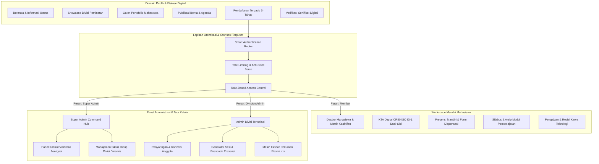

# Portal Terpadu Unit Kegiatan Mahasiswa Ilmu Komputer
### Universitas Bina Bangsa Getsempena (UBBG) Banda Aceh
**Enterprise Academic Ecosystem & Student Organization Management System**

<div align="center">

[](https://laravel.com)
[](https://php.net)
[](https://mysql.com)
[](https://phpunit.de)
[](https://laravel.com/docs/10.x/authorization)
[](https://developer.mozilla.org/en-US/docs/Web/CSS)
[](LICENSE)

</div>

---

## Daftar Isi
- [Ringkasan Eksekutif](#ringkasan-eksekutif)
- [Arsitektur Sistem & Aliran Data](#arsitektur-sistem--aliran-data)
- [Matriks Peran & Hak Akses (RBAC)](#matriks-peran--hak-akses-rbac)
- [Modul Fungsional Utama](#modul-fungsional-utama)
- [Standar Keamanan & Proteksi Sistem](#standar-keamanan--proteksi-sistem)
- [Spesifikasi Desain Antarmuka](#spesifikasi-desain-antarmuka)
- [Teknologi & Tumpukan Perangkat Lunak](#teknologi--tumpukan-perangkat-lunak)
- [Panduan Instalasi & Penerapan Lokal](#panduan-instalasi--penerapan-lokal)
- [Kredensial Pengujian Bawaan](#kredensial-pengujian-bawaan)
- [Pengujian Otomatis & Jaminan Kualitas](#pengujian-otomatis--jaminan-kualitas)
- [Struktur Repositori](#struktur-repositori)
- [Atribusi Pengembang & Akademik](#atribusi-pengembang--akademik)
- [Lisensi](#lisensi)

---

## Ringkasan Eksekutif

Portal Terpadu UKM Ilmu Komputer Universitas Bina Bangsa Getsempena (UBBG) merupakan platform tata kelola organisasi kemahasiswaan berbasis web enterprise. Sistem ini mengintegrasikan seluruh domain operasional organisasi—mulai dari penerimaan anggota baru multi-divisi, pengelolaan presensi pertemuan dengan verifikasi kode dinamis, kurasi portofolio proyek teknologi, hingga penerbitan dokumen resmi terstandarisasi seperti Kartu Tanda Anggota (KTA) digital dan Berita Acara Pertemuan.

Dibangun dengan arsitektur **Clean Model-View-Controller (MVC)** pada kerangka kerja **Laravel 10**, sistem ini menerapkan prinsip pemisahan tanggung jawab (*Separation of Concerns*), isolasi otorisasi lintas divisi yang ketat (*anti-Insecure Direct Object Reference*), serta bahasa desain antarmuka **White Claymorphism** yang sepenuhnya responsif pada berbagai resolusi perangkat.

---

## Arsitektur Sistem & Aliran Data

Sistem beroperasi melalui empat domain utama yang saling terisolasi dengan lapisan otentikasi terpusat:



---

## Matriks Peran & Hak Akses (RBAC)

Sistem menerapkan pembatasan hak akses berbasis peran secara ketat melalui middleware otentikasi dan kebijakan otorisasi Eloquent:

| Modul Fungsional | Tamu (Publik) | Anggota (Mahasiswa) | Admin Divisi | Super Admin |
|---|:---:|:---:|:---:|:---:|
| Akses Halaman Informasi & Berita | Ya | Ya | Ya | Ya |
| Registrasi Open Recruitment | Ya | Tidak (Telah Terdaftar) | Tidak | Tidak |
| Akses Workspace & KTA Digital | Tidak | Ya | Ya (Mode Anggota) | Ya (Mode Anggota) |
| Check-in Presensi Mandiri | Tidak | Ya (Divisi Terdaftar) | Tidak | Tidak |
| Pengajuan Portofolio Karya | Tidak | Ya | Tidak | Tidak |
| Kelola Presensi & Rilis Passcode | Tidak | Tidak | Ya (Khusus Divisinya) | Ya (Seluruh Divisi) |
| Moderasi Karya Mahasiswa | Tidak | Tidak | Ya (Khusus Divisinya) | Ya (Seluruh Divisi) |
| Ekspor Data Spreadsheet (.xls) | Tidak | Tidak | Ya (Khusus Divisinya) | Ya (Seluruh Divisi) |
| Konfigurasi Divisi & Kuota | Tidak | Tidak | Tidak | Ya |
| Konfigurasi Menu Navigasi | Tidak | Tidak | Tidak | Ya |
| Manajemen Akun & Penetapan Hak Akses | Tidak | Tidak | Tidak | Ya |
| Audit Trail Perubahan Status Akun | Tidak | Tidak | Tidak | Ya |

---

## Modul Fungsional Utama

### 1. Panel Kontrol Navigasi Publik Dinamis
Super Administrator diberikan wewenang penuh untuk mengatur visibilitas 9 item navigasi utama (*Beranda, Divisi, Karya, Berita, Agenda, Pengurus, Galeri, Verifikasi, Open Recruitment*) melalui panel kontrol grafis.
- Perubahan status visibilitas langsung diterapkan secara terpusat tanpa mengubah kode sumber template.
- Terintegrasi penuh pada tampilan bilah navigasi desktop maupun laci menu geser (*off-canvas drawer*) mobile.
- Penyimpanan pengaturan menggunakan model `Setting` yang dioptimasi dengan query berbasis indeks.

### 2. Siklus Hidup Divisi Dinamis
Divisi peminatan teknologi tidak lagi bersifat statis atau dikodekan secara kaku (*hardcoded*).
- Super Administrator dapat menambah divisi baru kapan saja dengan menetapkan nama, deskripsi, silabus, batas kuota penerimaan, dan ikon FontAwesome.
- Siklus status divisi mencakup *Aktif*, *Ditangguhkan*, hingga *Ditutup*, disertai mekanisme penghapusan aman (*Soft Deletes*).
- Form pendaftaran publik, kartu pilihan, serta filter dashboard secara otomatis membaca daftar divisi aktif langsung dari database.
- Penugasan penanggung jawab divisi dilakukan secara dinamis melalui antarmuka pencarian akun berbasis AJAX.

### 3. Transisi Peran Aman & Jejak Audit (Role Transition & Audit Trail)
Menjawab kebutuhan organisasi ketika seorang anggota biasa diangkat menjadi pengurus (atau sebaliknya):
- **Nol Kehilangan Data (Zero Data Loss):** Data keanggotaan mahasiswa, riwayat kehadiran pertemuan, berkas pendaftaran awal, dan portofolio tetap tersimpan utuh saat akun dipromosikan menjadi administrator.
- **Rollback Aman:** Akun pengurus dapat dikembalikan menjadi status anggota biasa kapan saja tanpa merusak relasi basis data.
- **Pencatatan Jejak Audit (Audit Logging):** Setiap tindakan perubahan peran dicatat secara permanen pada tabel `audit_logs`, mencakup ID eksekutor, peran sebelumnya, peran baru, alamat IP, waktu kejadian, dan catatan alasan perubahan.
- **Lencana Kepengurusan KTA (Leadership Badge):** Anggota yang merangkap jabatan pengurus mendapatkan lencana mahkota emas bertuliskan *"PENGURUS AKTIF"* pada Kartu Tanda Anggota digitalnya.
- **Pengalih Ruang Kerja Cepat (Dual-Mode Switcher):** Akses navigasi satu klik pada bilah navigasi atas untuk berpindah antara Panel CMS Admin dan Dasbor Mandiri Mahasiswa.

### 4. Pendaftaran Anggota Baru 3-Tahap (Industrial Recruitment Wizard)
Alur pendaftaran dirancang dengan pendekatan *finite state machine* berbasis JavaScript modular:
- **Tahap 1 (Identitas & Kredensial):** Pengisian data pribadi, NIM, nomor WhatsApp, alamat surel, dan pembuatan kata sandi akun dengan validasi kekuatan sandi.
- **Tahap 2 (Peminatan & Komitmen):** Pemilihan divisi teknologi melalui kartu interaktif, disertai indikator sisa kuota dinamis yang otomatis mengunci pilihan jika kapasitas telah terpenuhi.
- **Tahap 3 (Unggah Berkas Persyaratan):** Area unggah berkas (Pas Foto, Kartu Tanda Mahasiswa, Curriculum Vitae, dan Portofolio GitHub) dengan validasi tipe berkas dan batas ukuran instan di sisi klien sebelum data dikirim ke server.
- **Pengecekan Asinkron Real-Time:** Pengecekan keunikan NIM dan Email langsung berjalan saat pengguna berpindah kolom formulir.
- **Pembuatan Akun Otomatis:** Setelah registrasi berhasil, akun mahasiswa langsung tercipta dan sistem melakukan proses masuk (*auto-login*) ke dasbor status seleksi.

### 5. Kartu Tanda Anggota Digital Berstandar CR80 (ISO/IEC 7810 ID-1)
Dokumen identitas anggota resmi dirancang mengikuti spesifikasi fisik kartu identitas internasional:
- **Dimensi Presisi:** Rasio standar 85.6 mm × 53.98 mm dengan sudut lengkung 3.18 mm.
- **Sisi Depan:** Identitas nama lengkap, nomor registrasi anggota, NIM, program studi, fakultas, pas foto proporsional anti-distorsi (*canvas cover rendering*), segel hologram digital, dan QR Code verifikasi keaslian.
- **Sisi Belakang:** Strip magnetik pengaman visual, klausul tata tertib keanggotaan, stempel digital organisasi yang sah, serta representasi barcode Code-128.
- **Interaktivitas 3D:** Fitur pembalik kartu interaktif tiga dimensi untuk meninjau kedua sisi kartu.
- **Ekspor Dokumen Vektor:**
  - Penerbitan berkas **PDF Resmi 2 Halaman Lanskap** resolusi tinggi menggunakan `jsPDF`.
  - Ekspor gambar raster **PNG HD** per sisi kartu menggunakan `html2canvas`.

### 6. Presensi Mandiri Berbasis Passcode & Berita Acara Pertemuan
- **Sesi Pertemuan Terjadwal:** Instruktur divisi merilis sesi pertemuan baru lengkap dengan judul modul, capaian pembelajaran, tautan materi, dan durasi kedaluwarsa waktu.
- **Passcode 6-Karakter Dinamis:** Kehadiran mandiri hanya dapat divalidasi apabila mahasiswa memasukkan kode akses unik yang dibagikan secara langsung saat sesi berlangsung.
- **Formulir Dispensasi Resmi:** Fasilitas pelaporan izin atau sakit dengan kewajiban melampirkan berkas surat keterangan pendukung.
- **Berita Acara Perkuliahan (BAP):** Halaman cetak resmi siap tanda tangan yang memuat rekapitulasi kehadiran, instruktur bertugas, materi yang disampaikan, dan daftar kehadiran mahasiswa.

### 7. Mesin Ekspor Dokumen Spreadsheet Asli (.xls)
Platform dilengkapi layanan `ExcelExportService` terdedikasi untuk kebutuhan pelaporan eksekutif:
- Menggunakan standar MIME `application/vnd.ms-excel; charset=UTF-8` berbasis HTML Table Formatting.
- Dilengkapi Kop Surat Resmi UKM Ilmu Komputer dan Universitas Bina Bangsa Getsempena, nomor kontak, metadata waktu penerbitan, serta identitas admin penanggung jawab.
- **Proteksi Format Angka Teks (`mso-number-format:"\@"`)**: Menjamin Nomor Induk Mahasiswa (NIM), nomor telepon WhatsApp, dan kode registrasi tidak berubah menjadi notasi ilmiah (`2.4E+09`) atau kehilangan angka nol di depan saat dibuka di Microsoft Excel, LibreOffice Calc, maupun Google Sheets.
- Diterapkan pada data pendaftar open recruitment, direktori anggota aktif, dan presensi sesi pertemuan.

---

## Standar Keamanan & Proteksi Sistem

1. **Pencegahan Insecure Direct Object Reference (Anti-IDOR):**
   Setiap controller administrasi menerapkan validasi kepemilikan data yang ketat. Admin Divisi A diblokir secara otomatis dengan respon `403 Forbidden` jika mencoba membaca, memanipulasi, atau menghapus data milik Divisi B.

2. **Pembatasan Frekuensi Akses (Rate Limiting & Throttling):**
   Perlindungan terhadap serangan *brute force* dan *denial-of-service* diterapkan pada rute krusial:
   - Endpoint Masuk Sistem (`/login`): Maksimal 5 percobaan per menit.
   - Endpoint Pendaftaran (`/open-recruitment`): Maksimal 10 request per menit.
   - Endpoint Validasi Ketersediaan (`/open-recruitment/check-availability`): Maksimal 30 request per menit.
   - Endpoint Check-in Presensi (`/presensi/checkin`): Maksimal 6 percobaan per menit.

3. **Ketahanan Manajemen Sesi (Session Resilience):**
   Endpoint `/logout` dikonfigurasi untuk menangani permintaan `POST` maupun `GET`, serta dikecualikan dari verifikasi token CSRF kedaluwarsa guna mengeliminasi galat `419 Page Expired` ketika sesi peramban telah habis masa aktifnya.

4. **Sanitasi Data & Proteksi XSS:**
   Seluruh input pengguna disaring menggunakan form request validation dan Blade auto-escaping, mencegah injeksi kode berbahaya (*Cross-Site Scripting*).

---

## Spesifikasi Desain Antarmuka

Antarmuka dibangun dengan sistem desain kustom **White Claymorphism**:
- **Variabel Desain Terpusat:** Pengaturan warna, jarak (*spacing*), elevasi kartu, dan transisi didefinisikan secara rapi dalam berkas CSS tokens.
- **Elevasi Taktil:** Kombinasi bayangan luar lembut (*soft outer drop shadow*) dan bayangan dalam tipis (*subtle inner bevel highlight*) menghasilkan efek permukaan kartu fisik yang modern dan bersih.
- **Tipografi Terstruktur:** Menggunakan jenis huruf *Plus Jakarta Sans* untuk keterbacaan teks antarmuka dan *JetBrains Mono* untuk identifikasi data teknis, NIM, dan kode akses.
- **Adaptabilitas Perangkat:** Grid tata letak fleksibel yang menyesuaikan tampilan secara proporsional dari layar smartphone 320px hingga monitor resolusi tinggi.

---

## Teknologi & Tumpukan Perangkat Lunak

| Komponen | Spesifikasi & Pustaka |
|---|---|
| **Bahasa Pemrograman** | PHP 8.1 / 8.2 |
| **Kerangka Kerja Backend** | Laravel 10.x (Arsitektur MVC) |
| **Sistem Basis Data** | MySQL 8.0 / MariaDB 10.4+ / SQLite (Pengujian) |
| **Bahasa Gaya Antarmuka** | Vanilla CSS3 (Arsitektur Token Desain Kustom) |
| **Ikonografi** | FontAwesome 6 Free Web Font |
| **Tipografi** | Google Fonts (Plus Jakarta Sans, JetBrains Mono) |
| **Mesin Dokumen Klien** | html2canvas (Rasterisasi DOM), jsPDF (Penyusun Vektor PDF) |
| **Mesin Dokumen Server** | Native XML/HTML Spreadsheet Synthesis (`ExcelExportService`) |
| **Alat Uji Mutu** | PHPUnit 10.x |
| **Lingkungan Eksekusi** | Laragon / Apache / Nginx / Linux Server |

---

## Panduan Instalasi & Penerapan Lokal

### 1. Kebutuhan Sistem
- PHP versi 8.1 ke atas dengan ekstensi aktif: `pdo_mysql`, `mbstring`, `fileinfo`, `gd`, `openssl`, `curl`.
- [Composer](https://getcomposer.org/) versi 2.0 ke atas.
- MySQL Server versi 8.0 ke atas atau MariaDB.
- Git Version Control.

### 2. Kloning Repositori
```bash
git clone https://github.com/gempurbudianarki/ukmubbg.git
cd ukmubbg
```

### 3. Instalasi Dependensi PHP
```bash
composer install --optimize-autoloader --no-dev
```
*(Gunakan `composer install` tanpa flag jika dalam tahap pengembangan).*

### 4. Konfigurasi Lingkungan (.env)
Buat salinan berkas konfigurasi lingkungan:
```bash
cp .env.example .env
```

Buka berkas `.env` dan sesuaikan parameter koneksi basis data:
```env
APP_NAME="UKM Ilmu Komputer UBBG"
APP_ENV=local
APP_KEY=
APP_DEBUG=true
APP_URL=http://127.0.0.1:8000

DB_CONNECTION=mysql
DB_HOST=127.0.0.1
DB_PORT=3306
DB_DATABASE=ukm_ilkom
DB_USERNAME=root
DB_PASSWORD=
```

### 5. Pembuatan Kunci Aplikasi
```bash
php artisan key:generate
```

### 6. Eksekusi Skema Basis Data & Data Awal
```bash
php artisan migrate:fresh --seed
```

### 7. Tautan Penyimpanan Berkas Publik
```bash
php artisan storage:link
```

### 8. Menjalankan Server Pengembangan
```bash
php artisan serve --host=127.0.0.1 --port=8000
```
Akses sistem melalui peramban web pada alamat: **http://127.0.0.1:8000**

---

## Kredensial Pengujian Bawaan

Basis data telah dilengkapi akun pengujian siap pakai untuk masing-masing tingkatan peran:

| Peran Akun | Cakupan Divisi | Alamat Surel (Email) | Kata Sandi | Alamat Tujuan Masuk |
|---|---|---|---|---|
| Super Administrator | Seluruh Organisasi | `admin@ukmilkom.id` | `admin123` | `/admin/dashboard` |
| Administrator Divisi | Pemrograman | `pemrograman@ukmilkom.id` | `pemrograman123` | `/admin/dashboard` |
| Administrator Divisi | Multimedia | `multimedia@ukmilkom.id` | `multimedia123` | `/admin/dashboard` |
| Administrator Divisi | Internet of Things | `iot@ukmilkom.id` | `iot123` | `/admin/dashboard` |
| Administrator Divisi | Cyber Security | `cyber@ukmilkom.id` | `cyber123` | `/admin/dashboard` |
| Anggota (Mahasiswa) | Pemrograman | `bintang@student.ac.id` | `student123` | `/student/dashboard` |

> Sistem secara otomatis mendeteksi peran pengguna saat proses masuk berhasil. Anggota diarahkan langsung ke Workspace Mahasiswa, sedangkan pengurus diarahkan ke Dasbor Command Center.

---

## Pengujian Otomatis & Jaminan Kualitas

Integritas kode program diverifikasi secara berkelanjutan menggunakan rangkaian pengujian fungsional terautomasi:

```bash
php artisan test
```

### Metrik Hasil Eksekusi Uji Mutu:
```text
   PASS  Tests\Feature\AdminDashboardTest
   PASS  Tests\Feature\AttendanceAdminTest
   PASS  Tests\Feature\AttendanceSelfCheckinTest
   PASS  Tests\Feature\DynamicDivisionLifecycleTest
   PASS  Tests\Feature\ExcelExportTest
   PASS  Tests\Feature\MemberAdminTest
   PASS  Tests\Feature\NavigationControlTest
   PASS  Tests\Feature\OfficerAdminTest
   PASS  Tests\Feature\RecruitmentAdminTest
   PASS  Tests\Feature\RecruitmentConversionTest
   PASS  Tests\Feature\RecruitmentSettingsAdminTest
   PASS  Tests\Feature\RecruitmentWindowGuardTest
   PASS  Tests\Feature\RecruitmentWorkflowTest
   PASS  Tests\Feature\SecurityAndAccessControlTest
   PASS  Tests\Feature\StudentDashboardAccessTest
   PASS  Tests\Feature\StudentMeetingMaterialReaderTest
   PASS  Tests\Feature\StudentProfileEditTest
   PASS  Tests\Feature\StudentProjectShowcaseAndModerationTest
   PASS  Tests\Feature\StudentRegistrationAndAuthTest
   PASS  Tests\Feature\UkmPortalTest
   PASS  Tests\Feature\UserAdminTest

   Total Uji Kasus : 128 Passed
   Total Asersi    : 591 Assertions
   Waktu Eksekusi  : ~10.4 Detik
   Status Evaluasi : 100% Lulus (Green Suite)
```

---

## Struktur Repositori

```text
ukm/
├── app/
│   ├── Http/
│   │   ├── Controllers/
│   │   │   ├── Admin/             # Controller Pusat Kendali Administrasi
│   │   │   ├── Student/           # Controller Ruang Kerja Mandiri Mahasiswa
│   │   │   └── ...                # Controller Layanan Publik & Otentikasi
│   │   └── Middleware/            # Pengaman Hak Akses, Throttle, & Sanitasi Sesi
│   ├── Models/                    # Definisi Entitas Relasi Eloquent
│   └── Services/                  # Lapisan Logika Bisnis & Mesin Dokumen
├── database/
│   ├── migrations/                # Skema Tabel & Relasi Basis Data
│   └── seeders/                   # Pemasok Data Awal Akun & Konfigurasi
├── public/
│   ├── css/                       # Definisi Token Desain White Claymorphism
│   ├── js/                        # Komponen Skrip Klien (Wizard, KTA Renderer)
│   └── images/                    # Aset Grafis, Lambang Organisasi, & Lambang Kampus
├── resources/
│   └── views/
│       ├── admin/                 # Template Tampilan Antarmuka Pengurus
│       ├── student/               # Template Tampilan Ruang Kerja Anggota & KTA
│       ├── home/                  # Template Tampilan Etalase Digital Publik
│       └── layouts/               # Kerangka Induk Bilah Navigasi & Kaki Halaman
├── routes/
│   └── web.php                    # Deklarasi Pemetaan Rute Web & Pelindung Akses
└── tests/
    └── Feature/                   # Berkas Pengujian Fitur Fungsional & Keamanan
```

---

## Atribusi Pengembang & Akademik

Platform ini dikembangkan dan dipelihara secara resmi oleh:

**Gempur Budi Anarki**  
Program Studi Ilmu Komputer  
Fakultas Sains, Teknologi, dan Ilmu Kesehatan (FSTIK)  
Universitas Bina Bangsa Getsempena (UBBG), Banda Aceh  

Repositori Kode: [https://github.com/gempurbudianarki/ukmubbg](https://github.com/gempurbudianarki/ukmubbg)  
Laman Resmi Kampus: [https://bbg.ac.id](https://bbg.ac.id)  

---

## Lisensi

Proyek ini didistribusikan secara terbuka di bawah naungan lisensi [MIT License](LICENSE).  
Hak Cipta (c) 2026 Unit Kegiatan Mahasiswa Ilmu Komputer — Universitas Bina Bangsa Getsempena. Seluruh hak cipta dilindungi undang-undang.
