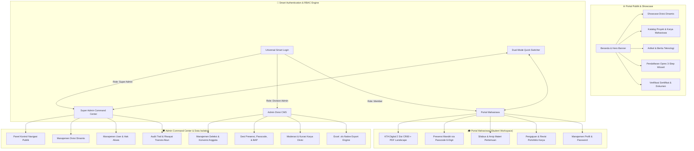

# 🌟 Portal Terpadu UKM Ilmu Komputer — UBBG

<div align="center">

[](https://laravel.com)
[](https://php.net)
[](https://mysql.com)
[-success?style=for-the-badge&logo=phpunit&logoColor=white)](https://phpunit.de)
[](#-keamanan--arsitektur-isolasi)
[](#-desain-antarmuka--pengalaman-pengguna-uiux)
[](LICENSE)

<p align="center">
  <b>Sistem Manajemen Ekosistem Terpadu & Portal Web Resmi Unit Kegiatan Mahasiswa (UKM) Ilmu Komputer</b><br>
  <i>Universitas Bina Bangsa Getsempena (UBBG) Banda Aceh</i>
</p>

[Fitur Utama](#-fitur-unggulan-sistem) • [Arsitektur](#-arsitektur-ekosistem) • [Panduan Instalasi](#-panduan-instalasi--menjalankan-lokal) • [Kredensial Akun](#-akun-uji-coba-bawaan-seed-credentials) • [Pengujian](#-pengujian-otomatis-automated-testing) • [Pengembang](#-pengembang-developer)

---

</div>

## 📖 Tentang Proyek

**Portal Terpadu UKM Ilmu Komputer UBBG** adalah platform terintegrasi generasi modern yang dirancang untuk mengelola seluruh siklus hidup organisasi mahasiswa di bidang teknologi informasi dan komputasi. Platform ini menjembatani calon pendaftar, anggota aktif, instruktur divisi, serta pimpinan organisasi melalui arsitektur multi-peran yang tangguh, otomatisasi dokumen resmi berstandar industri, serta perlindungan integritas data lintas divisi.

Dibangun dengan arsitektur **Clean MVC Laravel**, memadukan estetika antarmuka **Modern White Claymorphism** yang lembut dan taktil, sistem otentikasi cerdas berbasis multi-role (*Super Admin, Admin Divisi, dan Anggota/Mahasiswa*), serta otomatisasi dokumen pintar seperti **Kartu Tanda Anggota (KTA) Digital 2 Sisi**.

---

## 🏛️ Arsitektur Ekosistem

Sistem memisahkan tanggung jawab dan isolasi data secara ketat antara domain publik, portal mandiri mahasiswa, dan command center administrasi:



---

## ✨ Fitur Unggulan Sistem

### 1. 🎛️ Panel Kontrol Navigasi & Menu Publik (Dynamic Navigation Switcher)
- **Kontrol Instan Tanpa Sentuh Kode:** Super Admin memiliki panel pengaturan terpusat untuk mengaktifkan atau menonaktifkan 9 menu tombol publik (*Beranda, Divisi, Karya, Berita, Agenda, Pengurus, Galeri, Verifikasi, Open Recruitment*).
- **Sinkronisasi Multi-Device:** Status visibilitas tombol otomatis tersinkronisasi di header desktop navbar maupun *mobile off-canvas drawer*.
- **Keamanan Konfigurasi:** Disimpan dalam database secara persisten dengan fallback default yang aman.

### 2. 🏛️ Siklus Hidup Divisi Dinamis (Dynamic Division Lifecycle Hub)
- **Fleksibilitas Tanpa Batas:** Penambahan divisi peminatan teknologi baru kapan saja tanpa perlu mengubah kode sumber atau skema database.
- **Pengelolaan Komprehensif:** Dukungan ikon kustom (FontAwesome), kuota penerimaan, silabus kompetensi, status (*Aktif / Ditangguhkan / Ditutup*), dan *Soft Delete*.
- **Penugasan Admin Divisi Cerdas:** Super Admin dapat menugaskan pimpinan divisi secara langsung melalui modal interaktif dengan pencarian akun otomatis.

### 3. 🔄 Transisi Aman Anggota ⇄ Admin (Safe Role Transition & Audit Trail)
- **Integritas Data Terlindungi:** Ketika seorang anggota biasa dipromosikan menjadi admin divisi/super admin (atau sebaliknya):
  - Seluruh riwayat presensi, data pendaftaran, NIM, dan portofolio karya tetap utuh (*zero data loss*).
  - Mekanisme **Safe Rollback** memungkinkan pengembalian status ke anggota biasa kapan saja dengan aman.
  - Setiap perubahan peran dicatat ke dalam **Audit Trail Log** yang merekam identitas eksekutor, tanggal, dan alasan perubahan.
- **Badge Mahkota Prestise KTA (Leadership Crown):** Anggota yang merangkap sebagai pengurus mendapatkan lencana mahkota emas eksklusif bertuliskan *"PENGURUS AKTIF"* pada KTA digitalnya.
- **Dual-Mode Workspace Switcher:** Tombol pintas cepat di header memungkinkan admin berpindah antara portal manajemen CMS dan portal mahasiswa hanya dengan satu klik.

### 4. 📝 Sistem Pendaftaran Oprec Modern (Industrial 3-Step Wizard)
- **State-Machine Frontend Tangguh:** Formulir bertahap (*Step 1: Data Diri & Akun*, *Step 2: Pilihan Divisi & Motivasi*, *Step 3: Berkas Persyaratan*) dengan validasi ketat per tahap.
- **Pengecekan Ketersediaan Real-Time:** Pengecekan duplikasi NIM dan Email secara asinkron (AJAX) sebelum form dikirim.
- **Countdown Kuota Dinamis:** Menampilkan sisa kuota divisi secara *live*. Apabila kuota habis, kartu divisi otomatis terkunci dengan label *"Kuota Penuh"*.
- **Otomatisasi Akun Mahasiswa:** Begitu pendaftaran selesai, akun login mahasiswa otomatis dibuat dan langsung aktif.

### 5. 📊 Engine Ekspor Excel (.xls) Eksekutif
- **Bukan Sekadar CSV Biasa:** Menghasilkan dokumen spreadsheet Microsoft Excel asli dengan MIME `application/vnd.ms-excel; charset=UTF-8`.
- **Kop Surat Resmi & Metadata:** Dilengkapi Kop Resmi UKM Ilmu Komputer & UBBG, nomor kontak, metadata waktu cetak, dan nama administrator penanggung jawab.
- **Proteksi Format Angka Teks (`mso-number-format`):** Menjamin NIM dan nomor WhatsApp tidak berubah menjadi notasi ilmiah (`2.4E+09`) dan tidak kehilangan angka `0` di awal.
- **Estetika Dokumen:** Tata letak rapi dengan header navy profesional, garis pembatas (border), zebra striping abu-abu lembut (`#f8fafc`), dan badge status berwarna.
- **Tersedia Pada:**
  - Laporan Seleksi Calon Anggota (Open Recruitment)
  - Direktori Data Anggota Resmi
  - Rekapitulasi Presensi per Sesi Pertemuan

### 6. 🪪 Kartu Tanda Anggota (KTA) Digital 2 Sisi (CR80 ISO ID-1)
- **Standar Kartu Fisik Presisi:** Didesain dengan rasio standar internasional kartu identitas (CR80 / 85.6mm × 53.98mm).
- **Interaktivitas 3D:** Animasi rotasi flip kartu 3D yang halus untuk melihat sisi depan dan belakang.
- **Sisi Depan:** Identitas resmi, pas foto proporsional anti-distorsi (*canvas cover rendering*), NIM, Program Studi, Fakultas, hologram keaslian, dan QR Code verifikasi.
- **Sisi Belakang:** Strip magnetik keamanan cerdas, ketentuan tata tertib resmi keanggotaan, stempel digital sah, dan barcode fisik Code-128.
- **Ekspor Dokumen Canggih:**
  - 📄 **Cetak PDF Resmi 2 Halaman Lanskap** resolusi tinggi menggunakan `jsPDF`.
  - 🖼️ **Unduh PNG HD** terpisah untuk keperluan digital.

### 7. ⏱️ Presensi Mandiri Berbasis Passcode Dinamis
- **Kode Kehadiran 6-Karakter:** Instruktur/admin divisi merilis kode akses acak harian dengan batas kedaluwarsa waktu.
- **Formulir Dispensasi & Izin:** Input keterangan izin/sakit dengan unggah surat bukti pendukung.
- **Berita Acara Perkuliahan (BAP):** Cetak BAP resmi pertemuan divisi format cetak siap tanda tangan dan ekspor spreadsheet.

### 8. 🛡️ Keamanan & Arsitektur Isolasi
- **Strict Cross-Division Authorization:** Admin Divisi A tidak dapat melihat, mengubah, menghapus, atau mengekspor data milik Divisi B (teruji IDOR-proof).
- **Rate-Limiter & Brute-Force Shields:** Pembatasan frekuensi percobaan request (throttling) pada endpoint otentikasi login, formulir oprec, ketersediaan NIM, dan presensi check-in.
- **Penanganan Sesi Tahan Banting:** Endpoint `/logout` aman dari error `419 Page Expired` (mendukung `POST` & `GET` serta sanitasi token CSRF).

---

## 🎨 Desain Antarmuka & Pengalaman Pengguna (UI/UX)

Platform ini mengadopsi bahasa desain **Modern White Claymorphism**:
- **Taktil & Ergonomis:** Bayangan ganda (*dual-layer soft shadows*) dan highlight tepi (*inner bevel highlight*) yang memberikan kesan kartu timbul modern.
- **Aksen Warna Kampus Terkurasi:** Palet biru laut (*Deep Navy `#0f172a`*), biru safir (*Sapphire `#1e40af`*), dan aksen keemasan (*Prestige Gold `#f59e0b`*).
- **Tipografi Modern:** Kombinasi harmonis **Plus Jakarta Sans** untuk antarmuka publik dan **JetBrains Mono** untuk data teknis, NIM, dan kode passkey.
- **Responsif Sepenuhnya:** Dioptimalkan secara menyeluruh dari layar smartphone terkecil (320px) hingga layar desktop ultra-wide.

---

## 🛠️ Teknologi & Stack

| Layer | Komponen & Pustaka |
|---|---|
| **Core Framework** | [Laravel 10.x](https://laravel.com) |
| **Language Runtime** | [PHP 8.1+](https://php.net) |
| **Database Engine** | MySQL 8.0 / MariaDB / SQLite |
| **Styling & System** | Custom Vanilla CSS (Design Tokens, White Claymorphism Engine) |
| **Iconography & Fonts** | FontAwesome 6 Free, Plus Jakarta Sans, JetBrains Mono |
| **Spreadsheet Engine** | Custom Native `ExcelExportService` (XML/HTML MIME with MSO Formats) |
| **Client-Side Rendering** | `html2canvas` & `jsPDF` (High-DPI Vector Document Synthesis) |
| **Quality Assurance** | PHPUnit 10 (128 Feature Tests, 591 Assertions, 100% Green) |
| **Server Environment** | Laragon / Nginx / Apache |

---

## 🚀 Panduan Instalasi & Menjalankan Lokal

### 1. Prasyarat Sistem
Pastikan lingkungan lokal Anda telah terpasang:
- PHP `>= 8.1` dengan ekstensi: `pdo_mysql`, `mbstring`, `fileinfo`, `gd`, `openssl`, `curl`
- [Composer](https://getcomposer.org/) `>= 2.x`
- MySQL Server `>= 8.0` atau MariaDB
- Git

### 2. Kloning Repositori
```bash
git clone https://github.com/gempurbudianarki/ukmubbg.git
cd ukmubbg
```

### 3. Instalasi Dependensi PHP
```bash
composer install
```

### 4. Konfigurasi Environment (.env)
Salin berkas template environment:
```bash
cp .env.example .env
```

Buka berkas `.env` dan sesuaikan koneksi database Anda:
```env
APP_NAME="UKM Ilmu Komputer UBBG"
APP_ENV=local
APP_KEY=
APP_DEBUG=true
APP_URL=http://127.0.0.1:8000

DB_CONNECTION=mysql
DB_HOST=127.0.0.1
DB_PORT=3306
DB_DATABASE=ukm_ilkom
DB_USERNAME=root
DB_PASSWORD=
```

### 5. Generate Application Key
```bash
php artisan key:generate
```

### 6. Migrasi Database & Seeder
Jalankan migrasi skema tabel beserta data awal otomatis:
```bash
php artisan migrate:fresh --seed
```

### 7. Buat Tautan Penyimpanan Berkas (Symlink Storage)
```bash
php artisan storage:link
```

### 8. Jalankan Server Lokal
```bash
php artisan serve --host=127.0.0.1 --port=8000
```
Aplikasi kini siap diakses melalui peramban web di: **[http://127.0.0.1:8000](http://127.0.0.1:8000)**

---

## 🔑 Akun Uji Coba Bawaan (Seed Credentials)

Semua akun pengujian di bawah ini siap digunakan langsung setelah proses seeder:

| Peran (Role) | Cakupan / Divisi | Email Login | Password | Destinasi Dashboard |
|---|---|---|---|---|
| **Super Administrator** | Seluruh Sistem | `admin@ukmilkom.id` | `admin123` | `/admin/dashboard` |
| **Admin Divisi** | Pemrograman | `pemrograman@ukmilkom.id` | `pemrograman123` | `/admin/dashboard` |
| **Admin Divisi** | Multimedia | `multimedia@ukmilkom.id` | `multimedia123` | `/admin/dashboard` |
| **Admin Divisi** | IoT | `iot@ukmilkom.id` | `iot123` | `/admin/dashboard` |
| **Admin Divisi** | Cyber Security | `cyber@ukmilkom.id` | `cyber123` | `/admin/dashboard` |
| **Mahasiswa (Member)** | Pemrograman | `bintang@student.ac.id` | `student123` | `/student/dashboard` |

> 💡 **Smart Redirect:** Sistem secara otomatis mendeteksi tipe peran akun saat login. Akun mahasiswa diarahkan langsung ke workspace anggota, sementara pengurus diarahkan ke panel CMS manajemen.

---

## 🧪 Pengujian Otomatis (Automated Testing)

Rangkaian pengujian otomatis mencakup seluruh aspek fungsionalitas, keamanan cross-division, proteksi IDOR, dan pipeline data ekspor:

```bash
php artisan test
```

### Ringkasan Status Verifikasi:
```text
   PASS  Tests\Feature\AdminDashboardTest
   PASS  Tests\Feature\AttendanceAdminTest
   PASS  Tests\Feature\AttendanceSelfCheckinTest
   PASS  Tests\Feature\DynamicDivisionLifecycleTest
   PASS  Tests\Feature\ExcelExportTest
   PASS  Tests\Feature\MemberAdminTest
   PASS  Tests\Feature\NavigationControlTest
   PASS  Tests\Feature\OfficerAdminTest
   PASS  Tests\Feature\RecruitmentAdminTest
   PASS  Tests\Feature\RecruitmentConversionTest
   PASS  Tests\Feature\RecruitmentWorkflowTest
   PASS  Tests\Feature\SecurityAndAccessControlTest
   PASS  Tests\Feature\StudentDashboardAccessTest
   PASS  Tests\Feature\StudentProjectShowcaseAndModerationTest
   ...

   Tests:    128 passed (591 assertions)
   Duration: 10.43s
   Status:   100% GREEN (All Tests Passing)
```

---

## 📁 Struktur Direktori Proyek

```text
ukm/
├── app/
│   ├── Http/
│   │   ├── Controllers/
│   │   │   ├── Admin/             # Controller Command Center (Divisi, Navigasi, Oprec, Presensi, User, dll.)
│   │   │   ├── Student/           # Controller Workspace Mahasiswa (KTA, Presensi, Silabus, Proyek)
│   │   │   └── ...                # Controller Publik (Home, Showcase, Oprec Wizard, Auth)
│   │   └── Middleware/            # Guard Autentikasi, Role Checker, & Rate Limiter Throttling
│   ├── Models/                    # Eloquent Models (User, Member, Division, Setting, Project, Attendance, dll.)
│   └── Services/                  # Business Logic Services (ExcelExportService, AuditLogger, dll.)
├── database/
│   ├── migrations/                # 20+ Skema Migrasi Database
│   └── seeders/                   # Seeder Data Awal & Akun Pengujian
├── public/
│   ├── css/                       # Design System CSS (White Claymorphism Engine)
│   ├── js/                        # Modul Skrip Klien (Recruitment Wizard, KTA Renderer, dll.)
│   └── images/                    # Aset Grafis & Logo Resmi
├── resources/
│   └── views/
│       ├── admin/                 # Blade Views Panel CMS Pengurus
│       ├── student/               # Blade Views Portal Mandiri Mahasiswa & KTA 2-Sisi
│       ├── home/                  # Blade Views Portal Publik & Showcase
│       └── layouts/               # Master Layouts (Navbar Dinamis, Footer, App Shell)
├── routes/
│   └── web.php                    # Deklarasi Routing Aplikasi
└── tests/
    └── Feature/                   # 30+ File Feature Test Cases (128 Tests, 591 Assertions)
```

---

## 👨‍💻 Pengembang (Developer)

<div align="center">

**Gempur Budi Anarki**  
*Program Studi Ilmu Komputer — Fakultas Sains, Teknologi, dan Ilmu Kesehatan (FSTIK)*  
**Universitas Bina Bangsa Getsempena (UBBG) Banda Aceh**  

[](https://github.com/gempurbudianarki)
[](https://bbg.ac.id)

</div>

---

## 📄 Lisensi

Proyek ini dirilis dan didistribusikan di bawah lisensi terbuka [MIT License](LICENSE).  
Hak Cipta © 2026 **Unit Kegiatan Mahasiswa (UKM) Ilmu Komputer — Universitas Bina Bangsa Getsempena**. Seluruh hak cipta dilindungi undang-undang.
